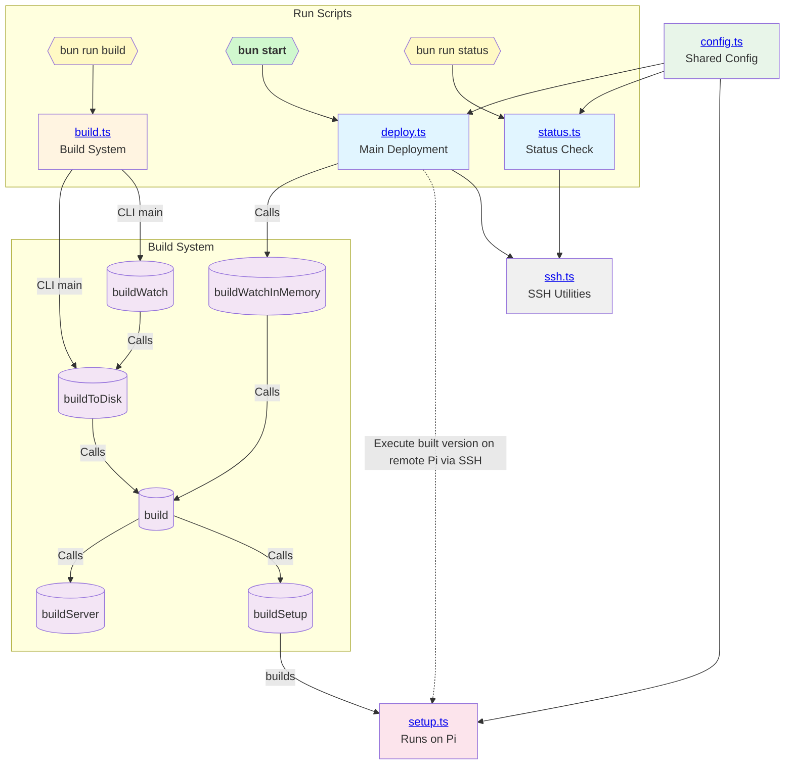

# Battery Charge & Discharge Controller

A real-time device monitoring and control application that interfaces with hardware over serial port, providing a web-based GUI for interaction and control.

## Technology Stack

This project uses **[Bun](https://bun.sh)** - a fast all-in-one JavaScript runtime that serves as our package manager, bundler, test runner, and JavaScript/TypeScript executor.

## Installation

### Bun Installation

#### Windows

```powershell
# Using PowerShell
powershell -c "irm bun.sh/install.ps1 | iex"
```

#### Linux / macOS / Raspberry Pi

```bash
curl -fsSL https://bun.sh/install | bash
```

For more installation options, visit [bun.sh](https://bun.sh)

### Project Setup

#### Development (Windows/macOS/Linux)

```bash
# Clone the repository
git clone https://github.com/cinderblock/battery-controller.git
cd battery-controller

# Install dependencies
bun install

# Run development server
bun run dev
```

#### Deployment to Raspberry Pi

This project is developed locally but runs on Raspberry Pi. **Everything is automated** - deployment runs from your development machine and handles the entire process.

**Configuration:**

```bash
# Configure deployment target
cp .env.example .env
# Edit .env - set DEPLOY_HOST and DEPLOY_USER

# Pi settings are hardcoded in the systemd service
# Edit on Pi if needed: /etc/systemd/system/battery-controller.service
```

**Deploy:**

```bash
# One command does everything:
# - Builds binaries for Pi (setup + server)
# - Transfers them via SSH
# - Runs setup (first time)
# - Installs/restarts service
bun run deploy
```

**Development Mode:**

```bash
# Watch for changes and auto-redeploy
bun run deploy:watch
```

**Check Status:**

```bash
# View remote Pi status
bun run status
```

See [Developer.md](./Developer.md) for detailed deployment documentation.

## Project Overview

### Architecture

- **Frontend**: Web-based GUI for device monitoring and control
- **Server**: Backend API that manages state and serial port communication
- **Run Scripts**: Deployment and management utilities for Raspberry Pi

#### Run Scripts Architecture

The following diagram shows how the run scripts interact with each other:



**Script Relationships:**

- **deploy.ts**: Main deployment orchestrator that builds the project, transfers files via SSH, and runs setup on the remote Pi
- **build.ts**: Build system that can be used programmatically or as CLI; exports functions for building setup and server bundles
- **ssh.ts**: SSH utility functions for file transfer and remote command execution
- **config.ts**: Shared configuration constants used by deployment and setup scripts
- **setup.ts**: Runs on the Raspberry Pi to configure system directories, services, and hardware
- **status.ts**: Checks remote Pi status via SSH

### Features

- Real-time serial port communication with connected hardware
- Raw byte-level protocol debugging (for reverse engineering unknown protocols)
- State synchronization between physical device and application
- Web-based user interface for monitoring and control
- Cell types (`/cell-types`): nominal capacity and per-cell charge/cutoff limits, validated per chemistry. A cell's type is what C-rate steps multiply by; a cell with no type can't start a C-rate test
- Automated deployment to Raspberry Pi

### Protocol Status

**⚠️ Protocol: Newline-Delimited (Content Format TBD)**

This codebase works with hardware using a newline-delimited serial protocol. Messages are separated by `\n` characters, but the content format of each line is still being determined.

**Known:**

- Message framing: Newline-delimited (`\n`)
- Each line is a complete message

**Unknown (requires reverse engineering):**

- Line content format (JSON, CSV, key=value, hex-encoded binary, etc.)
- Data fields and their meanings
- Command format

**Next Steps:**

1. Connect to the hardware and observe incoming lines
2. Determine the format of each line (JSON, CSV, etc.)
3. Implement parsing logic in `src/server/serial.ts` → `parseMessage()`
4. Update state structure in `src/server/state.ts` based on discovered data fields
5. Update command formatting in `serializeCommand()`

## Development

```bash
# Start development server (hot reload enabled)
bun run dev

# Run tests
bun test

# Build for production
bun run build

# Start production server
bun run start
```

## Documentation

See [layout.md](./layout.md) for detailed project structure and architecture documentation.

## Hardware Requirements

### Development Machine

- Windows 10/11, macOS, or Linux

### Deployment Target

Raspberry Pi with attached battery charger/discharge hardware.

## License

Copyright 2025 TWILL Technology Inc.

Permission is hereby granted, free of charge, to any person obtaining a copy of this software and associated documentation files (the “Software”), to deal in the Software without restriction, including without limitation the rights to use, copy, modify, merge, publish, distribute, sublicense, and/or sell copies of the Software, and to permit persons to whom the Software is furnished to do so, subject to the following conditions:

The above copyright notice and this permission notice shall be included in all copies or substantial portions of the Software.

THE SOFTWARE IS PROVIDED “AS IS”, WITHOUT WARRANTY OF ANY KIND, EXPRESS OR IMPLIED, INCLUDING BUT NOT LIMITED TO THE WARRANTIES OF MERCHANTABILITY, FITNESS FOR A PARTICULAR PURPOSE AND NONINFRINGEMENT. IN NO EVENT SHALL THE AUTHORS OR COPYRIGHT HOLDERS BE LIABLE FOR ANY CLAIM, DAMAGES OR OTHER LIABILITY, WHETHER IN AN ACTION OF CONTRACT, TORT OR OTHERWISE, ARISING FROM, OUT OF OR IN CONNECTION WITH THE SOFTWARE OR THE USE OR OTHER DEALINGS IN THE SOFTWARE.
